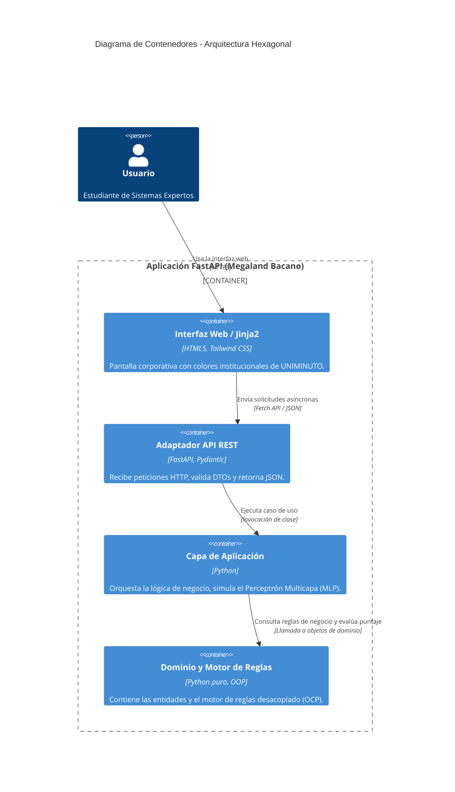

# Sistema Inteligente: Megaland Bacano 2026 🎵🤖
**Asignatura:** Sistemas Expertos — Unidad 3  
**Institución:** Corporación Universitaria Minuto de Dios (UNIMINUTO)  

Demostración académica de una aplicación web basada en **Arquitectura Hexagonal**, principios **SOLID**, **Código Limpio**, un **Motor de Reglas** desacoplado (cero `if-else` anidados) y un pipeline neuro-simbólico que combina la estimación probabilística de una Red Neuronal Artificial (MLP) con reglas estrictas de gobernanza institucional y explicabilidad contrafactual.

---

## 📂 Estructura del Proyecto

El proyecto está organizado bajo los principios de Arquitectura Hexagonal, separando estrictamente el núcleo de negocio de los adaptadores de infraestructura y frameworks web:

```text
megaland_uniminuto/
│
├── dominio/                    # Core de Negocio (Entidades puras y Reglas)
│   ├── __init__.py
│   ├── entidades.py            # Modelos inmutables (Asistente, Resultado)
│   └── reglas.py               # Clases independientes por regla (Principio OCP)
│
├── aplicacion/                 # Casos de Uso (Orquestación con verbos)
│   ├── __init__.py
│   └── evaluar_admision_caso_uso.py # Orquesta percepción, MLP y motor de reglas
│
├── infraestructura/            # Adaptadores externos, Frameworks y Drivers
│   ├── __init__.py
│   ├── motor_reglas.py         # Administrador y ejecutor de la cadena de reglas
│   └── api_fastapi.py          # Expone los endpoints REST de la aplicación
│
├── templates/                  # Interfaz Gráfica (HTML / Tailwind CSS / Jinja2)
│   └── index.html              # Pantalla web corporativa (Colores UNIMINUTO)
│
├── main.py                     # Punto de entrada de la aplicación FastAPI
└── requirements.txt            # Dependencias del proyecto
```
## 📐 Diagramas de Arquitectura

### 1. Diagrama de Arquitectura General

Este diagrama ilustra cómo fluyen los datos desde la interfaz de usuario corporativa hasta el núcleo de negocio a través de la Arquitectura Hexagonal y el Motor de Reglas.

Fragmento de código
```mermaid
graph TD
    subgraph UI ["Capa de Presentación (Infraestructura)"]
        A[Navegador Web / Tailwind CSS] -->|HTTP POST| B(FastAPI / Jinja2)
    end

    subgraph HEX ["Arquitectura Hexagonal (Core)"]
        B -->|DTO a Entidad| C(EvaluarAdmisionVIP - Caso de Uso)
        C -->|Percepción y Simulación MLP| D[Capa de Razonamiento Estadístico]
        D -->|Puntaje Continuo| E(MotorReglasAdmision)
        
        subgraph REGLAS ["Motor de Reglas (SOLID - OCP)"]
            E --> R1[ReglaMenorEdad]
            E --> R2[ReglaAccesoVIP]
            E --> R3[ReglaAccesoCondicional]
            E --> R4[ReglaAccesoEstandar]
        end
    end

    R1 --> F[(Resultado Evaluado con Explicación Contrafactual)]
    R2 --> F
    R3 --> F
    R4 --> F

    F -->|JSON Response| B
    B -->|Renderiza HTML| A
   ```
### 2. Modelo C4 - Nivel 1: Diagrama de Contexto del Sistema
Muestra al usuario (estudiante o profesor) interactuando con el sistema inteligente del festival.

Fragmento de código
```mermaid
C4Context
    title Diagrama de Contexto del Sistema - Megaland Bacano 2026

    Person(usuario, "Estudiante / Docente", "Interactúa con la plataforma web para evaluar accesos al festival.")
    System(sistema, "Sistema Inteligente UNIMINUTO", "Evalúa la percepción, ejecuta el modelo MLP y aplica reglas de gobernanza y contrafactuales.")

    Rel(usuario, sistema, "Envía datos de asistencia y visualiza resultados y explicaciones", "HTTPS / HTML")

    UpdateElementStyle(usuario, $bg="#004A93", $fontColor="#ffffff")
    UpdateElementStyle(sistema, $bg="#212844", $fontColor="#ffffff")
```
### 3. Modelo C4 - Nivel 2: Diagrama de Contenedores

Detalla los contenedores internos dentro de la aplicación FastAPI y su separación en capas hexagonales.

Fragmento de código

# ⚙️ Instalación y Ejecución


## Clonar o descargar el repositorio en tu entorno local.

```bash
python -m venv .venv
```

```bash
.venv\Scripts\activate.bat
```

### Instalar las dependencias listadas en el archivo requirements.txt:

Bash
```bash
pip install -r requirements.txt
```
Ejecutar el servidor local con Uvicorn:

Bash
```bash
uvicorn main:app --reload
```
Abrir el navegador e ingresar a: http://127.0.0.1:8000